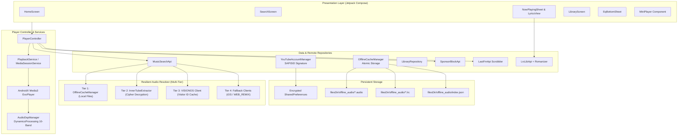

# VeltPulse 🎵

[](https://github.com/rejoanabir/VeltPulse/actions/workflows/android_ci.yml)
[](https://opensource.org/licenses/Apache-2.0)
[](https://developer.android.com)
[](https://github.com/rejoanabir/VeltPulse/releases)
[](https://kotlinlang.org)
[](https://developer.android.com/jetpack/compose)

**VeltPulse** is a modern, high-performance open-source music streaming application and local audio player for Android. Engineered with **Jetpack Compose** and **AndroidX Media3 (ExoPlayer)**, VeltPulse delivers an ad-free, privacy-respecting audio experience backed by an innovative multi-tier stream resolver, chunked offline caching, studio-grade DSP equalization, synchronized lyrics, and YouTube account integration.

---

## 📑 Table of Contents

- [Core Value Proposition](#-core-value-proposition)
- [Feature Matrix](#-feature-matrix)
- [System Architecture](#-system-architecture)
- [Quick Start Developer Guide](#-quick-start-developer-guide)
  - [Prerequisites](#prerequisites)
  - [Environment Setup](#environment-setup)
  - [Build Commands](#build-commands)
  - [Building in Termux / AndroidIDE](#building-in-termux--androidide)
- [Architecture Deep-Dive](#-architecture-deep-dive)
  - [Resilient Audio Resolver Pipeline](#resilient-audio-resolver-pipeline)
  - [Offline Cache Subsystem](#offline-cache-subsystem)
  - [YouTube Session & Security](#youtube-session--security)
- [Troubleshooting & FAQ](#-troubleshooting--faq)
- [Contributing](#-contributing)
- [License](#-license)

---

## 💡 Core Value Proposition

Commercial music platforms are increasingly cluttered with invasive advertisements, algorithmic tracking, dynamic compression artifacts, and restricted offline access. VeltPulse solves these problems:

1. **Zero Advertisements & Privacy First**: No tracking libraries, telemetry daemons, or injected audio ads.
2. **Resilient Multi-Tier Audio Stream Resolution**: Defeats YouTube throttling and `HTTP 403 Forbidden` errors through automatic fallback across four independent client implementations (`InnerTubeX`, `VISIONOS`, `Web Remix`, and `iOS`).
3. **Studio DSP Audio Engine**: Full 10-band parametric equalization via Android's hardware-accelerated `DynamicsProcessing` effect framework, featuring loudness normalization (-14 LUFS target) and AutoEq presets.
4. **Offline First with Chunked Downloads**: Downloads tracks in 1MB HTTP range slices to avoid bandwidth caps, storing audio alongside synchronized `.lrc` lyrics in a sanitized, tamper-resistant cache.
5. **Rich Metadata Ecosystem**: Real-time word-by-word synchronized lyrics from LrcLib with CJK Romanization, SponsorBlock crowd-sourced segment skips, and native Last.fm dual-stage scrobbling.

---

## 📊 Feature Matrix

| Feature | VeltPulse (v1.2.0) | Standard YouTube Music | Typical Open-Source Clients |
| :--- | :---: | :---: | :---: |
| **User Interface** | Modern Material 3 Glassmorphism | Material You | Standard Views / Legacy Compose |
| **Audio Playback Engine** | Media3 ExoPlayer + MediaSession | Proprietary Player | MediaSession / MediaPlayer |
| **Stream Failover** | 4-Tier Multi-Client Cascade | Single Client Endpoint | Single InnerTube Endpoint |
| **Offline Cache** | 1MB Range Chunking + Synced LRC | Encrypted DRM Container | Direct Single-Stream Dump |
| **Equalizer (DSP)** | 10-Band `DynamicsProcessing` | Basic 5-Band Graphic | Basic Android Equalizer |
| **Loudness Normalization** | Target -14 LUFS Perceptual Gain | Static / Album Only | None |
| **Synchronized Lyrics** | Word-by-word + Romanizer (LrcLib)| Line-synced | Plaintext or None |
| **SponsorBlock** | Built-in (Intros/Outros/Offtopic) | None | Varies (often absent) |
| **Scrobbling** | Native Last.fm (2-Phase API) | Via 3rd-party apps | Limited |
| **YouTube Account Sync** | Session Cookie + SAPISID Auth | Google Sign-in | Invidious/Piped only |

---

## 🏛 System Architecture

VeltPulse adheres to Clean Architecture and reactive, unidirectional data flow (MVI/MVVM) powered by Kotlin Coroutines and `StateFlow`.



---

## 🚀 Quick Start Developer Guide

### Prerequisites

| Tool | Version Requirement | Description |
| :--- | :--- | :--- |
| **JDK** | JDK 17 (Eclipse Temurin or OpenJDK) | Required for Gradle compilation & Kotlin compiler |
| **Android SDK** | API 37 (`compileSdk = 37`, `targetSdk = 36`, `minSdk = 28`) | Android SDK Platform Tools 36+ |
| **Android Gradle Plugin** | `9.3.1` | Build system runner |
| **Kotlin** | `2.3.21` | Language tooling |
| **IDE** | Android Studio Ladybug / AndroidIDE 2.7+ / Termux | Supported development environments |

### Environment Setup

1. **Clone the repository:**
   ```bash
   git clone https://github.com/rejoanabir/VeltPulse.git
   cd veltpulse
   ```

2. **Configure Signing Properties (Optional for Debug builds):**
   For release builds, configure `release.properties` in the project root:
   ```properties
   storeFile=release.keystore
   storePassword=your_keystore_password
   keyAlias=your_key_alias
   keyPassword=your_key_password
   ```

### Build Commands

* **Compile Debug APK:**
  ```bash
  ./gradlew assembleDebug --no-daemon --stacktrace
  ```
  *Output:* `app/build/outputs/apk/debug/app-debug.apk`

* **Run Unit Tests:**
  ```bash
  ./gradlew testDebugUnitTest --no-daemon
  ```

* **Execute Android Lint:**
  ```bash
  ./gradlew lintDebug
  ```

* **Build Signed Production Release APK & AAB:**
  ```bash
  ./gradlew assembleRelease bundleRelease --no-daemon --stacktrace
  ```
  *Output:* `app/build/outputs/apk/release/app-release.apk` and `app/build/outputs/bundle/release/app-release.aab`

### Building in Termux / AndroidIDE

VeltPulse is fully compatible with on-device development inside **Termux** and **AndroidIDE**:

```bash
# In Termux: ensure openjdk-17 and gradle are installed
pkg update && pkg install openjdk-17

# Export Java Home
export JAVA_HOME=$PREFIX/opt/openjdk-17
export PATH=$JAVA_HOME/bin:$PATH

# Grant execution rights to the wrapper and compile
chmod +x ./gradlew
./gradlew assembleDebug
```

---

## 🔍 Architecture Deep-Dive

For complete API specifications and data models, see [ARCHITECTURE.md](file:///storage/emulated/0/CodeOnTheGoProjects/VeltPulse/docs/ARCHITECTURE.md).

### Resilient Audio Resolver Pipeline

YouTube frequently throttles or returns `403 Forbidden` for standard web scrapers. VeltPulse guarantees playback availability using a prioritized 4-tier resolution pipeline in `MusicSearchApi.kt`:

1. **Tier 1 (Local Storage)**: Checks `OfflineCacheManager` or on-device `content://` MediaStore URIs. Playback begins instantly without network requests.
2. **Tier 2 (InnerTubeExtractor)**: Decodes stream URLs using `YouTubeCipherService` with remote player configuration caching.
3. **Tier 3 (VISIONOS Client)**: Emulates Apple Vision Pro client requests (`clientName: VISIONOS`, `clientVersion: 1.02`, `X-YouTube-Client-Name: 101`). Retrieves dynamic visitor authorization tokens from `https://www.youtube.com/sw.js_data` (cached with 12-hour TTL). Selects highest quality Opus (`itag 251`, ~160kbps) or AAC (`itag 140`, ~128kbps) streams while extracting track perceptual loudness metadata (`perceptualLoudnessDb`).
4. **Tier 4 (Multi-Client Fallback)**: Cascades through `IOS` (`client 5`, version `19.45.4`) and `WEB_REMIX` (`client 67`) player configurations.

### Offline Cache Subsystem

The offline cache operates inside `context.filesDir/offline_audio/` with strict security and data integrity constraints:

* **Chunked Range Transfers**: Tracks are downloaded in 1MB (`1024 * 1024L`) chunks using HTTP `Range: bytes=X-Y` requests. This circumvents YouTube's server-side audio stream bitrate throttle. If the server does not support partial content (HTTP 200), it seamlessly falls back to streaming mode.
* **Path Traversal Protection**: All audio and lyrics file paths are vetted through `isPathSafe()`:
  ```kotlin
  file.canonicalPath.startsWith(dir.canonicalPath)
  ```
* **Atomic Index Transactions**: Metadata index writes are protected by a coroutine `Mutex` (`indexMutex.withLock`) and written atomically via temporary swap files (`index.json.tmp` -> `index.json`).

### YouTube Session & Security

* **SAPISID Authentication**: Authenticated InnerTube endpoints require custom digest authorization signatures generated from the `SAPISID` cookie:
  $$\text{SAPISIDHASH} = \text{timestamp} + \text{"\_"} + \text{SHA1}(\text{timestamp} + \text{" "} + \text{SAPISID} + \text{" "} + \text{origin})$$
* **Security Isolation**: Credentials reside exclusively in Android's private `MODE_PRIVATE` SharedPreferences. Logging out flushes and clears both application preferences and the Android WebKit `CookieManager`.

---

## 🛠 Troubleshooting & FAQ

### Audio playback fails with "Unable to play track"
* **Cause**: YouTube IP rate limiting or expired visitor token.
* **Resolution**: VeltPulse automatically advances through its 4-tier fallback and auto-skips to the next item if the stream is dead. To force-refresh cached visitor IDs, restart the application or switch between Wi-Fi and mobile data.

### YouTube Login does not import playlists
* **Cause**: Missing `SAPISID` or `LOGIN_INFO` cookies during authentication.
* **Resolution**: In **Settings → YouTube Account**, tap **Sign In** and complete the web login process until the YouTube Music home screen fully loads. Ensure cookies are permitted.

### Downloaded songs do not appear in Library
* **Cause**: Interrupted download before the atomic rename step.
* **Resolution**: Incomplete downloads are isolated in `.tmp` files and purged automatically on restart to prevent database corruption. Restart the download from the track menu.

---

## 🤝 Contributing

We welcome contributions from the community!
1. Fork the repository.
2. Create your feature branch (`git checkout -b feature/amazing-feature`).
3. Commit your changes (`git commit -m 'feat: add amazing feature'`).
4. Push to the branch (`git push origin feature/amazing-feature`).
5. Open a Pull Request.

Ensure all unit tests pass before submitting (`./gradlew testDebugUnitTest`).

---

## 📄 License

VeltPulse is distributed under the terms of the **Apache License 2.0**. See [LICENSE](file:///storage/emulated/0/CodeOnTheGoProjects/VeltPulse/LICENSE) for details.
