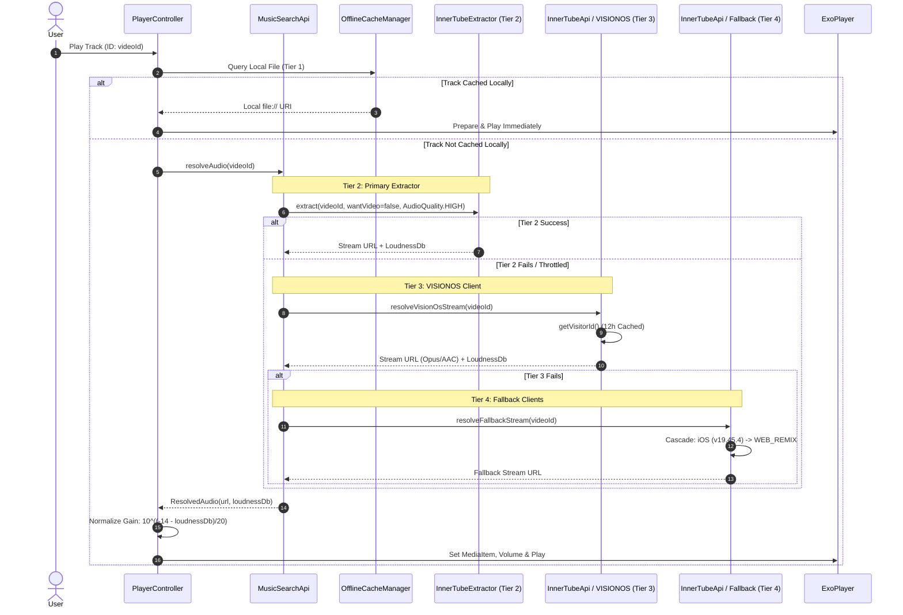
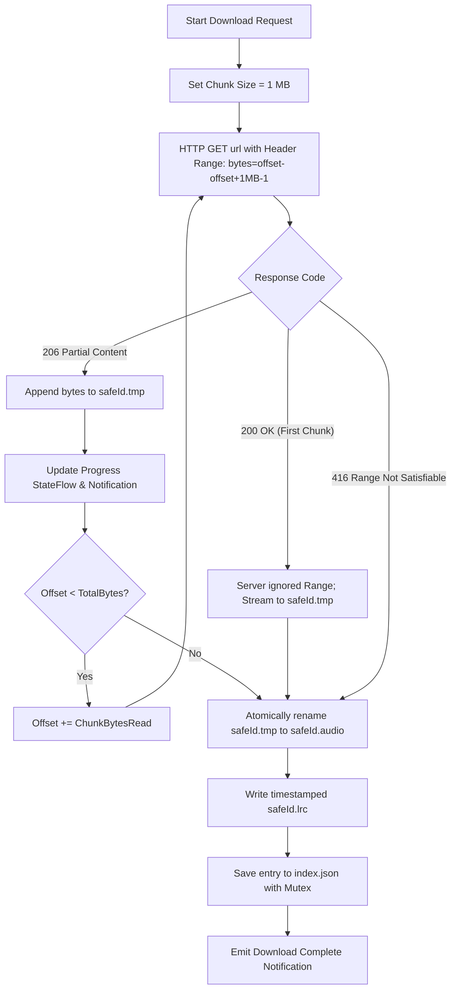

# VeltPulse Architecture & Developer API Specification

This document provides comprehensive technical documentation for the core architectural subsystems of **VeltPulse**, specifically covering the **Resilient Audio Resolver Pipeline**, the **Offline Cache Subsystem**, and the **YouTube Session & Authentication Interceptors**.

---

## 1. Resilient Audio Resolver Pipeline

### 1.1 Architecture Overview

Due to anti-scraping countermeasures and IP-based bitrate throttling implemented by YouTube, single-client stream resolution is prone to transient `HTTP 403 Forbidden` errors, player script signature failures, and silent stalls. VeltPulse addresses this via a **4-Tier Priority Cascade Pipeline** encapsulated in `MusicSearchApi.kt` and `InnerTubeApi.kt`.



### 1.2 Pipeline Tiers in Detail

#### Tier 1: Local Offline / On-Device Storage
- **Trigger**: Checked synchronously in `PlayerController.kt` before network invocation.
- **Criteria**: Matches any track with an existing file in `context.filesDir/offline_audio/$safeId.audio`, an explicit `content://` MediaStore URI, or an audio ID prefixed with `local_`.
- **Latency**: $0\text{ ms}$ network overhead.

#### Tier 2: Primary InnerTubeExtractor
- **Engine**: `com.metrolist.innertubex.extraction.InnerTubeExtractor` configured with `YouTubeCipherService` and `RemotePlayerConfigStore`.
- **Target**: High-bitrate audio streams decoded from YouTube Music Web Remix client endpoints.
- **Failover Trigger**: Any exception during extraction or blank stream URL response.

#### Tier 3: VISIONOS Client with Dynamic Visitor ID
- **Target Client**: Apple Vision Pro (`clientName: "VISIONOS"`, `clientVersion: "1.02"`, `X-YouTube-Client-Name: "101"`).
- **Visitor ID Resolution**:
  - Requires valid Google visitor telemetry data (`visitorData` / `X-Goog-Visitor-Id`).
  - **Tier A Scraping**: Scrapes `https://www.youtube.com/sw.js_data` for regex `(Cgt[a-zA-Z0-9%_-]{20,})`.
  - **Tier B Scraping**: Scrapes `https://www.youtube.com` homepage for `VISITOR_DATA` token.
  - **Cache TTL**: In-memory token cached for $12\text{ hours}$ (`VISITOR_ID_TTL_MS = 43,200,000L`).
- **Format Filtering Hierarchy**:
  1. `itag 251` (WebM / Opus, ~160 kbps, 48 kHz stereo)
  2. `itag 140` (MP4 / AAC, ~128 kbps, 44.1 kHz stereo)
  3. Highest reported `bitrate` where `mimeType.startsWith("audio/")`
- **Loudness Extraction**:
  Extracts `perceptualLoudnessDb` or `trackAbsoluteLoudnessLkfs` from `playerConfig.audioConfig`.

#### Tier 4: Multi-Client Fallback
- **Target Clients**:
  - `IOS`: Client Number `5`, Client Version `19.45.4`, User Agent: `com.google.ios.youtube/19.45.4 (iPhone16,2; U; CPU iOS 17_5_1 like Mac OS X; US)`.
  - `WEB_REMIX`: Client Number `67`, Client Version `1.20241118.01.00`.
- **Payload**: Standard InnerTube `v1/player` JSON payload with appended `visitorData`.

### 1.3 Loudness Normalization Specification

VeltPulse implements ITU-R BS.1770 compliant dynamic loudness normalization in `PlayerController.kt` to eliminate volume disparity between tracks:

$$\text{Volume Multiplier} = 10^{\frac{-14.0 - \text{loudnessDb}}{20.0}}$$

- **Target Standard**: $-14.0\text{ LUFS}$ (streaming broadcast standard).
- **Gain Clamping**: Coerced into range $[0.25, 1.0]$ to protect against clipping or inaudible attenuation.
- **Fallback**: If `loudnessDb` is `null`, player volume defaults to $1.0$.

### 1.4 Automatic Failover & Consecutive Error Resilience

If all 4 tiers fail to resolve a valid audio URL for a given track:
1. `consecutiveResolutionFailures` counter is incremented.
2. If the current queue length is $> 1$ and `consecutiveResolutionFailures < queue.size`:
   - An asynchronous notification toast is dispatched (`Unable to play '<track>'. Skipping to next...`).
   - `PlayerController` automatically triggers `skipNext()` after a 300 ms debounce delay.
3. If consecutive failures exceed the queue length:
   - Playback stops gracefully without crashing or creating an infinite skip loop.
   - User is alerted to check network connectivity.

---

## 2. Offline Cache Subsystem

### 2.1 File System Topology

All offline assets are kept strictly inside the application's private internal storage directory:

```
context.filesDir/
└── offline_audio/
    ├── index.json               # Master track registry (Atomic JSON)
    ├── index.json.tmp           # Transient atomic write swap file
    ├── <safeId>.audio           # Downloaded raw audio byte stream
    ├── <safeId>.tmp             # In-flight progressive download buffer
    └── <safeId>.lrc             # Standard timestamped LRC lyric file
```

### 2.2 Sanitization & Path Traversal Defense

Track IDs originate from external APIs and can contain arbitrary string characters. To prevent directory traversal attacks (`../../`):
1. **ID Sanitization**:
   ```kotlin
   private fun sanitizeTrackId(trackId: String): String {
       return trackId.filter { it.isLetterOrDigit() || it == '-' || it == '_' }
   }
   ```
2. **Canonical Path Guard**:
   Every file operation is guarded by `isPathSafe(file)`:
   ```kotlin
   private fun isPathSafe(file: File): Boolean {
       return runCatching {
           file.canonicalPath.startsWith(dir.canonicalPath)
       }.getOrDefault(false)
   }
   ```

### 2.3 Master Index Schema (`index.json`)

The index file contains an array of `SavedTrack` objects serialized with `kotlinx.serialization`:

```json
[
  {
    "id": "dQw4w9WgXcQ",
    "title": "Never Gonna Give You Up",
    "artist": "Rick Astley",
    "album": "Whenever You Need Somebody",
    "durationMs": 213000,
    "artworkUrl": "https://lh3.googleusercontent.com/...",
    "streamUrl": ""
  }
]
```

#### Field Definitions:
- `id` (String, Required): Sanitized YouTube video identifier.
- `title` (String, Required): Display track title.
- `artist` (String, Required): Primary artist display name.
- `album` (String, Optional): Album title, empty string if unavailable.
- `durationMs` (Long, Optional): Total duration in milliseconds.
- `artworkUrl` (String, Optional): High-resolution artwork URL (upscaled to 800x800).
- `streamUrl` (String, Optional): Empty in offline storage (retrieved via `getLocalUri()`).

### 2.4 Atomic Transaction Pattern

To ensure zero corruption of `index.json` during unexpected app terminations or power losses:
1. `indexMutex.withLock` ensures single-threaded write access across all coroutines.
2. Data is written in full to `index.json.tmp`.
3. Destination `index.json` is deleted and `index.json.tmp` is renamed atomically to `index.json` via filesystem inode swap.

### 2.5 Chunked Range Download Engine

Standard streaming URLs provided by YouTube apply progressive bandwidth throttling to prevent scraping. VeltPulse's `OfflineCacheManager` bypasses this limitation using a **Chunked HTTP Range Streaming Engine**:



- **Chunk Size**: Fixed at $1\text{ MB}$ ($1,048,576\text{ bytes}$).
- **Rate-Limiting Notification Ticker**: System progress notifications are throttled to a maximum frequency of $400\text{ ms}$ to prevent Android notification queue congestion.
- **Cancellation**: Cancelling an active download cleanly aborts the active OkHttp `Call`, terminates the coroutine `Job`, removes the `.tmp` file from disk, and dismisses the status bar notification.

---

## 3. YouTube Session Security & Authentication Interceptors

### 3.1 Authentication Architecture

VeltPulse integrates with YouTube Music accounts without using WebView credential hooks or insecure OAuth web views. Authentication uses session cookies provided by the user via manual cookie input or embedded login.

```
YouTubeAccount Data Model:
├── isLoggedIn: Boolean
├── name: String
├── handle: String
├── avatarUrl: String
└── rawCookie: String
```

### 3.2 Required Session Cookies

For an account session to be considered valid, `rawCookie` must contain at least one of:
1. `SAPISID`
2. `__Secure-3PAPISID`
3. `LOGIN_INFO`

### 3.3 SAPISIDHASH Signature Generation

Protected YouTube InnerTube endpoints (`account/account_menu`, `browse` for `FEmusic_liked_playlists`) reject standard cookie headers unless accompanied by an authorization digest. VeltPulse generates this signature dynamically using SHA-1:

```kotlin
fun generateSapisidHash(sapisid: String, origin: String = "https://music.youtube.com"): String {
    val timestamp = System.currentTimeMillis() / 1000
    val input = "$timestamp $sapisid $origin"
    val sha1 = MessageDigest.getInstance("SHA-1").digest(input.toByteArray(Charsets.UTF_8))
    val hash = sha1.joinToString("") { "%02x".format(it) }
    return "SAPISIDHASH ${timestamp}_$hash"
}
```

### 3.4 Interceptor Request Headers

Whenever authenticated InnerTube requests are built, `YouTubeAccountManager.getAuthHeaders()` attaches the following security context:

| Header Name | Value / Format | Purpose |
| :--- | :--- | :--- |
| `Cookie` | Raw session cookie string | Session identification |
| `Authorization` | `SAPISIDHASH <timestamp>_<sha1_hex>` | Anti-CSRF cryptographic proof |
| `Origin` | `https://music.youtube.com` | Origin binding |
| `Referer` | `https://music.youtube.com/` | Referrer validation |
| `X-Origin` | `https://music.youtube.com` | InnerTube web client verification |

### 3.5 Session Lifecycle & Logout Guarantee

1. **Storage Isolation**: Cookies and account profiles are stored inside `veltpulse_youtube_auth.xml` with `Context.MODE_PRIVATE`. Other applications have zero read access.
2. **Purge Guarantee**: Calling `YouTubeAccountManager.logout()`:
   - Clears all preferences in `veltpulse_youtube_auth`.
   - Resets the in-memory `_account` StateFlow to an empty instance.
   - Clears all cookies from the Android WebKit Cookie Manager (`removeAllCookies(null)` and `flush()`) to prevent lingering sessions.
